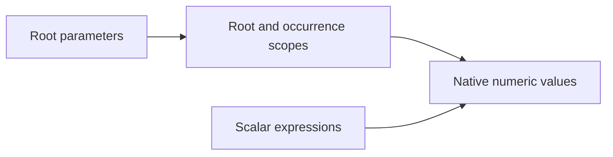

# Keep editable ASC occurrences on native sheets

ADR-0022 · Codex · 2026-11-24 · Clarified 2026-11-26 · Version 1.1

Audience — Core and desktop maintainers

## Decision

We use native occurrence sheets with document-owned definitions and ordered boundary connections for imported ASC hierarchies.

## Context

Several block calls can use one ASC definition. Each block call can supply different parameter overrides. A named flag can identify a child port without a separate SPICE input or output record. A port current must use the current paths on the child side of its boundary connection. [Issue #48](https://github.com/tinix84/GeckoCIRCUITS/issues/48) owns the scope.

## Options

| Option | Pros | Cons | Effort |
|---|---|---|---|
| Native sheet for each occurrence with shared definition keys | Keeps child sheets editable and preserves each block placement | Requires edit coordination and validation of peer sheets | Medium |
| Share one mutable sheet object | Stores one instance of the body | Cannot give each native block ownership of its sheet and parent context | Medium |
| Flatten to a solver graph during import | Gives the solver a direct device list | Loses native child editing and boundary current identity | Low |

## Decision and rationale

The document owns the formal port list and default parameter expressions for each definition. A native block owns its occurrence sheet, block placement, and caller override expressions. Definition member keys link native components and wires across occurrences. The editor applies a shared change to the linked members in one undo transaction. The native circuit file stores the editable members and their associations.

Preparation evaluates override expressions in the caller's parameter scope. The callee uses these values with its remaining defaults. Topology resolution records sheet-local membership before it connects the boundaries and global ground. The AC solver uses the final groups for its equations. Port currents sum signed child branch currents and nested port currents using the sheet-local groups.

For a document without AC settings, ordered root parameter definitions supply the caller scope. Parameter-dependent native scalar slots retain their source expressions. Figure 1 shows their relationship. Each ASC source keeps one definition key across different parameter overrides. Specializing that key by evaluated values would lose shared edit identity.

Figure 1 — Scope evaluation supplies native values without changing shared definition identity.

Parameter edits validate the proposed scopes and numeric values before committing either change. Shared body validation compares expressions for bound slots and literal values for unbound slots. AC documents retain their existing parameter owner and typed laws.

## Consequences

- The core and desktop validate versioned hierarchy fields and shared body consistency.
- The AC result identifies source members by occurrence path, local member key, and original port order. Flat results keep their existing schema.
- An ASC inductor retains its explicit series resistance in the native AC law. Transient execution rejects this law until the transient engine can apply it.
- Text netlist definitions, model libraries, and non-ground globals require separate decisions and evidence.
- Component imports require a separate document when merging cannot preserve their scalar binding scope.

## Status

Accepted for the ASC hierarchy slice on 2026-11-24.
The analysis-independent scalar binding clarification applies from 2026-11-26. It does not add transient hierarchy execution or FRA/DC sweep engines.
